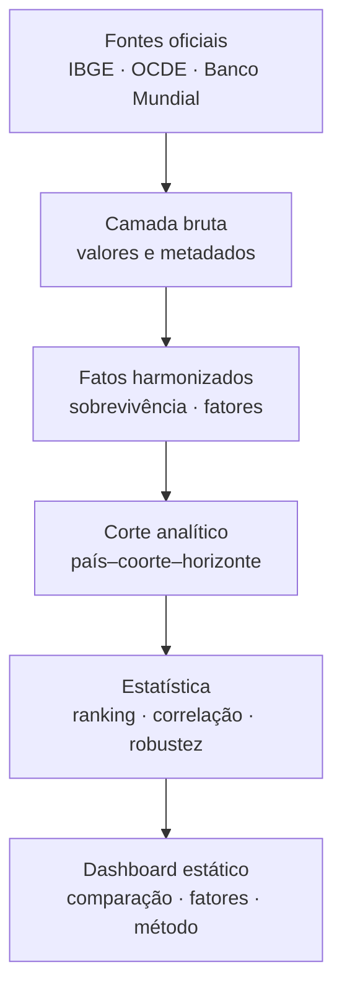

# Arquitetura do piloto — sobrevivência empresarial

## Pergunta de pesquisa proposta

> Quais características do ambiente econômico, institucional, financeiro e
> tributário estão associadas à sobrevivência de empresas empregadoras no Brasil
> e em países selecionados da OCDE?

O foco em sobrevivência não elimina a tributação. Ela passa de objeto único a uma
das dimensões explicativas, ao lado de financiamento, instituições, mercados,
capital humano, inovação e condições macroeconômicas.

## Recorte comparável do piloto

| Elemento | Definição |
|---|---|
| Unidade | País–coorte–horizonte |
| População | Empresas empregadoras |
| Coorte | Empresas nascidas em 2017 |
| Horizonte | Três anos |
| Observação | 2020 |
| Amostra | Brasil + 25 países da OCDE |
| Fonte do Brasil | IBGE, Demografia das Empresas 2022 |
| Fonte internacional | OCDE, *Entrepreneurial Ecosystem Diagnostics 2025*, tabela A B.2 |

A inferência do ano da coorte segue a definição do indicador de sobrevivência em
três anos: para uma observação em 2020, acompanha-se a coorte nascida em 2017.

## Modelo de dados

Arquivos centrais:

| Arquivo | Grão | Finalidade |
|---|---|---|
| `fact_survival.csv` | país–série–coorte–horizonte | Preserva conceito, fonte e nível de comparabilidade |
| `fact_factors.csv` | país–fator–período | Mantém fatores em formato longo, com unidade e papel temporal |
| `cross_section_2017_2020.csv` | país | Ranking comparável do desfecho |
| `panel_survival_ecosystem_pilot.csv` | país | Protótipo para exploração multivariada |
| `coverage_matrix.csv` | país | Expõe dados presentes e ausentes |
| `correlations_pilot.csv` | fator | Pearson, Spearman, p, q-BH e sensibilidade leave-one-out |

## Níveis de comparabilidade

| Nível | Uso | Regra |
|---|---|---|
| A | Comparação principal | Mesma população, coorte, horizonte e ano de observação |
| B | Contexto | Conceito próximo, mas ano ou horizonte diferente |
| C | Apenas histórico nacional | Quebra de método ou população empresarial diferente |

A taxa brasileira de 36,3% para a coorte de 2013 pertence à série antiga de
empresas ativas. Ela não é encadeada com a curva de empresas empregadoras da
coorte de 2017.

## Guardrails estatísticos implementados

1. O desfecho comparável fica separado da camada explicativa.
2. Cada correlação informa número de países; valores ausentes não são imputados.
3. São exibidos Pearson e Spearman, evitando depender apenas da linearidade.
4. O p-valor nominal é acompanhado da correção Benjamini–Hochberg para dez testes.
5. A faixa *leave-one-country-out* mostra quanto o coeficiente muda ao retirar um país.
6. O dashboard informa o desalinhamento entre o desfecho de 2020 e os escores
   compostos da OCDE de 2020–2023.
7. Nenhuma associação é descrita como impacto causal.

## Arquitetura das telas

| Tela | Mensagem | Visual principal |
|---|---|---|
| Comparação | Onde o Brasil se situa | Ranking horizontal do corte A |
| Fatores & correlações | Quais hipóteses merecem investigação | Dispersão interativa e painel de robustez |
| Trajetória do Brasil | Em que momento a coorte mais se reduz | Curva de sobrevivência de um a cinco anos |
| Cobertura & método | O que sustenta cada gráfico | Matriz de disponibilidade e links de fonte |

## Camadas explicativas recomendadas para a versão acadêmica

As variáveis devem ser medidas antes ou no nascimento da coorte. Para a coorte de
2017, a especificação preferível usa valores de 2016 ou médias de 2014–2016.

| Dimensão | Indicadores candidatos | Fonte preferencial |
|---|---|---|
| Tributação | carga/PIB, composição, imposto corporativo, cunha fiscal sobre trabalho | OCDE Revenue Statistics e Taxing Wages |
| Macroeconomia | PIB per capita, crescimento, inflação, desemprego | World Development Indicators |
| Crédito | crédito privado/PIB, taxa de juros, financiamento a PMEs | Banco Mundial e OECD Financing SMEs |
| Instituições | qualidade regulatória, Estado de direito, abertura de empresas | Worldwide Governance Indicators e OCDE |
| Capital humano | escolaridade, qualificação, produtividade | OCDE e Banco Mundial |
| Inovação | P&D/PIB, patentes, adoção digital | OCDE Main Science and Technology Indicators |
| Estrutura produtiva | composição setorial, tamanho e idade empresarial | OECD Business Demography e IBGE |

O modelo principal deve controlar, no mínimo, composição setorial e tamanho das
empresas. Sem esses controles, diferenças de sobrevivência podem refletir a
estrutura da amostra, não o ambiente de negócios.

## Publicação

O dashboard usa HTML, CSS, JavaScript e SVG, sem biblioteca de visualização ou
servidor. A pasta `dashboard/` é autocontida e pode ser hospedada como site
estático. A atualização dos dados é feita por `src/build_survival_pilot.py`, que
regenera `assets/data.js`, o CSV para download e as tabelas analíticas.

Para uma versão pública, recomenda-se:

1. criar um repositório versionado;
2. executar o pipeline em uma rotina de atualização;
3. publicar a pasta `dashboard/` por GitHub Pages ou Cloudflare Pages;
4. exibir versão dos dados, data de atualização e histórico de mudanças;
5. incluir um DOI ou snapshot arquivável para a versão usada no relatório final.

## Decisão recomendada após o piloto

O enfoque é válido, mas a pesquisa não deve afirmar ainda “quais fatores mais
afetam” a sobrevivência. Com dados observacionais e o painel atual, a formulação
defensável é “quais fatores estão associados”. A expressão “mais afetam” exige
uma estratégia causal, por exemplo reforma tributária/regulatória com desenho de
diferenças-em-diferenças ou outro experimento quase natural.
